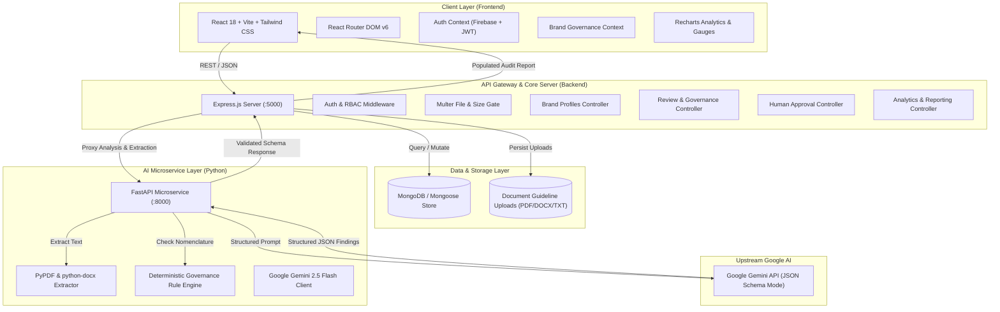
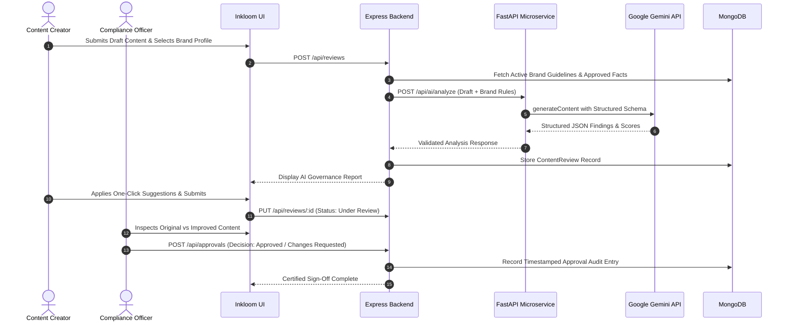

# Inkloom AI – System Architecture Documentation

## Intelligent Brand Governance Platform

---

## 1. Executive Summary

**Inkloom AI** is an enterprise-grade AI-powered SaaS platform engineered to ensure consistent, compliant, and trustworthy brand communication across decentralized marketing teams, agencies, and generative AI creation tools.

### Core Value Proposition
> *"Create confidently. Stay consistent. Protect your brand."*

Inkloom AI solves critical corporate communication risks:
1. **Unsubstantiated & False Claims**: Eliminating regulatory violations before release.
2. **Tone & Voice Drift**: Preserving brand personality, formality, and audience resonance.
3. **Restricted & Inconsistent Vocabulary**: Enforcing corporate nomenclature and preferred terminology.
4. **Human Accountability**: Guaranteeing that AI findings serve as explainable advisory recommendations, with certified human sign-off required for final publication.

---

## 2. Multi-Tier Architecture Diagram

---

## 3. Component Breakdown

### A. Frontend (`frontend/`)
- **Framework**: React 18 with Vite for lightning-fast HMR and bundle optimization.
- **Styling**: Tailwind CSS with custom enterprise design tokens:
  - Primary Deep Indigo (`#4338CA`)
  - Secondary Violet (`#7C3AED`)
  - Accent Teal (`#14B8A6`)
  - Background Slate (`#F8FAFC`)
  - Status Indicators (Success `#16A34A`, Warning `#F59E0B`, Error `#DC2626`)
- **Visualizations**: Recharts for violation distributions, monthly quality trends, and decision breakdowns; custom SVG radial `ScoreGauge`.
- **State Management**: React Context (`AuthContext`, `BrandContext`) with localStorage persistence and one-click demo login presets.

### B. Backend (`backend/`)
- **Framework**: Node.js & Express.js.
- **Database**: MongoDB with Mongoose object modeling.
- **Authentication**: Flexible authentication middleware supporting Firebase Auth ID tokens, local signed JWTs, and secure development demo bypasses.
- **Document Ingestion**: Multer file handler supporting PDF, DOCX, TXT, and image assets up to 15MB.
- **Resilience**: Integrated local heuristic governance engine if AI microservice or Gemini API key is offline, ensuring zero downtime.

### C. AI Microservice (`ai-service/`)
- **Framework**: Python 3 FastAPI with Uvicorn ASGI server.
- **AI Model**: Google Gemini 2.5 Flash via structured JSON generation.
- **Document Processing**: `pypdf` and `python-docx` for native text extraction from uploaded style guides.
- **Strict Anti-Hallucination Policy**: If a factual claim cannot be verified against the brand's approved fact repository, the engine strictly marks it as `"Requires Human Verification"`. The AI never invents rules or assumes unverified facts.

---

## 4. End-to-End Content Governance Workflow

---

## 5. Security & Isolation Architecture

1. **Workspace Isolation**: Content and brand guidelines are segregated by organizational ownership and user credentials.
2. **Environment Secret Protection**: Zero hardcoded keys; secrets are loaded from `.env` files (`GEMINI_API_KEY`, `MONGODB_URI`, `JWT_SECRET`).
3. **Safe File Handling**: Uploaded documents are sanitized, validated by mime-type and extension, and constrained by size limits.
4. **Human In The Loop**: Final publication status is cryptographically tied to human reviewer decisions; the AI engine possesses no publishing permissions.
